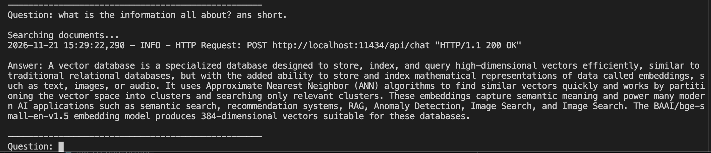

# RAG PDF Question-Answering System

Local RAG pipeline using **LlamaIndex + Ollama** — optimized for **MacBook M1 8GB RAM**.
Based on activity instructions with smallest model substitution.

## Models

| Model | Size | Role | Source |
|-------|------|------|--------|
| `qwen2:0.5b` | **352 MB** | LLM (generation) | Ollama |
| `BAAI/bge-small-en-v1.5` | **~130 MB** | Embeddings | HuggingFace |

**Total model memory: ~500 MB** — leaves ~7.5 GB for macOS + Python + vector index.

> **Note:** Instructions specify `llama3` (4.7 GB). Using `qwen2:0.5b` (352 MB) — smallest Ollama model — to fit 8 GB RAM.

## Quick Start

### Terminal 1 — Start Ollama
```bash
ollama serve
```

### Terminal 2 — Run App
```bash
cd rag-llamaindex-ollama
pip install -r requirements.txt   # one-time
python main.py
```

## Usage
```
Question: What is the main topic of this file?
Answer: The document discusses vector databases...

Question: exit
Goodbye!
```

## Add Documents
Drop PDFs into `data/` folder, then re-run.

## Demo



## Per Instructions
- `ollama pull qwen2:0.5b` (instead of `llama3`)
- Uses `HuggingFaceEmbedding(model_name="BAAI/bge-small-en-v1.5")` as specified
- LlamaIndex high-level abstraction: `VectorStoreIndex`, `SimpleDirectoryReader`, `Settings`